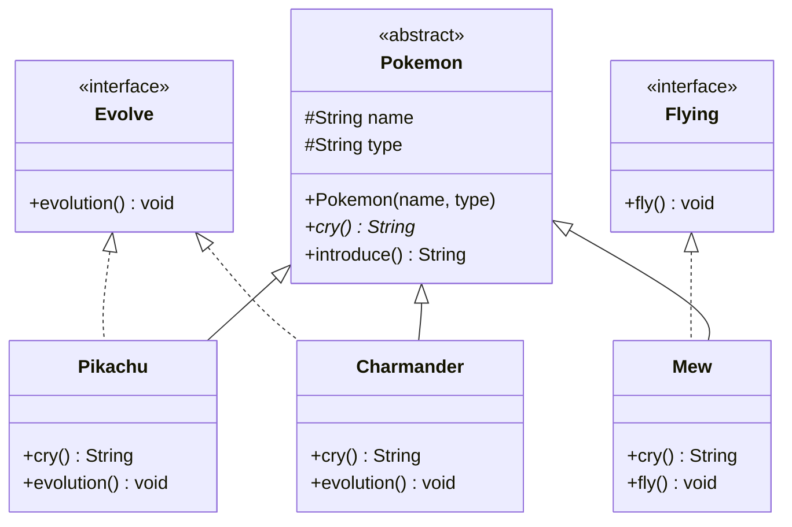

# Pokemon Pokedex: Studi Kasus OOP (Java)

Program Pokedex sederhana. Ada Pokemon yang **bisa evolution** (Pikachu, Charmander), ada yang **tidak bisa evolution** (Mew), dan ada yang **bisa terbang** (Mew). Studi kasus ini menunjukkan abstract class, interface, inheritance, dan polymorphism.

## Class Diagram



Note: Garis full atau penuh = extends, garis putus putus = implements
## Struktur File

| File | Jenis | Keterangan |
|------|-------|------------|
| `Pokemon.java` | Abstract class | Kerangka dasar semua Pokemon |
| `Evolve.java` | Interface | Kemampuan "bisa evolution" |
| `Flying.java` | Interface | Kemampuan "bisa terbang" |
| `Pikachu.java` | Class | Extends `Pokemon`, implements `Evolve` |
| `Charmander.java` | Class | Extends `Pokemon`, implements `Evolve` |
| `Mew.java` | Class | Extends `Pokemon`, implements `Flying` |
| `Main.java` | Class | Program utama untuk menjalankan semuanya |

## Penjelasan Konsep

### 1. Abstract Class (`Pokemon`)
Abstract class adalah class yang **tidak bisa dibuat objeknya** langsung (`new Pokemon()` akan error). Class ini dipakai sebagai kerangka untuk class turunan.

Alasan `Pokemon` dibuat abstract: "Pokemon" hanya konsep umum, yang ada di dunia nyata adalah Pikachu, Charmander, dan seterusnya. Abstract class juga menyimpan data dan perilaku yang sama untuk semua Pokemon:
- Field `name` dan `type` dipakai bersama oleh semua subclass.
- Method `introduce()` adalah method biasa yang langsung diwariskan, jadi tidak perlu ditulis ulang di tiap subclass.

### 2. Abstract Method (`cry()`)
`cry()` dideklarasikan tanpa isi di `Pokemon`:

```java
public abstract String cry();
```

Artinya **setiap subclass wajib membuat versinya sendiri**. Pikachu bersuara "Pika Pika!", Charmander "Char!", Mew "Mew~". Kalau subclass lupa meng-override, kode tidak bisa di-compile.

### 3. Interface (Evolve, Flying)
Interface adalah **kontrak kemampuan**: ia menyatakan apa yang bisa dilakukan, bukan bagaimana caranya.

Kenapa `evolution()` dan `fly()` tidak ditaruh saja di `Pokemon`? Karena **tidak semua Pokemon punya kemampuan itu**. Mew tidak punya evolusi, dan Pikachu tidak bisa terbang. Dengan interface, hanya class yang butuh yang mengambil kemampuan tersebut:

| Pokemon | Evolve | Flying |
|---------|:---------:|:-------:|
| Pikachu | ya | tidak |
| Charmander | ya | tidak |
| Mew | tidak | ya |

Satu class bisa `implements` banyak interface, sedangkan `extends` hanya boleh satu class. Itu sebabnya kemampuan dibuat sebagai interface.

### 4. Inheritance (Pewarisan)
`Pikachu`, `Charmander`, dan `Mew` memakai `extends Pokemon`, sehingga mereka **mewarisi** field `name`, `type`, dan method `introduce()` tanpa menulis ulang.

Hubungannya adalah **"is-a"**: Pikachu ADALAH Pokemon. Constructor subclass memanggil `super(name, type)` untuk mengisi data milik parent.

### 5. Method Overriding
Subclass menulis ulang method dari parent/interface dengan anotasi `@Override`:
- `cry()` dari `Pokemon` di-override oleh ketiga Pokemon.
- `evolution()` dari `Evolve` di-override oleh Pikachu dan Charmander (isinya berbeda: menjadi Raichu atau Charmeleon).
- `fly()` dari `Flying` di-override oleh Mew.

### 6. Polymorphism
Di `Main`, array bertipe `Pokemon` berisi objek yang berbeda-beda:

```java
Pokemon[] pokedex = { new Pikachu(), new Charmander(), new Mew() };
```

Saat `p.cry()` dipanggil di dalam loop, kodenya sama untuk semua, tetapi **hasilnya berbeda sesuai objek aslinya**. Java memilih method yang tepat saat program berjalan

Interface juga dipakai sebagai tipe: dengan `instanceof Evolve` dan `instanceof Flying`, program mengecek dulu apakah sebuah Pokemon punya kemampuan tersebut sebelum memanggilnya.

## Alur Program
1. `Main` membuat 3 Pokemon dan memasukkannya ke array `Pokemon[]`.
2. Tiap Pokemon memperkenalkan diri dengan `introduce()` (method warisan) dan bersuara dengan `cry()` (hasil overriding).
3. Jika Pokemon `Evolve`, ia berevolusi dan namanya berubah. Jika tidak, program mencetak bahwa ia tidak bisa evolution.
4. Jika Pokemon `Flying`, ia terbang.

## Contoh Output
```
=== Pikachu (Electric) ===
Suara: Pika Pika!
Pikachu berevolusi menjadi Raichu!
Sekarang: Raichu (Electric)

=== Charmander (Fire) ===
Suara: Char!
Charmander berevolusi menjadi Charmeleon!
Sekarang: Charmeleon (Fire)

=== Mew (Psychic) ===
Suara: Mew~
Mew (Psychic) tidak bisa evolution.
Mew melayang di udara.
```

## Abstract Class vs Interface

| | Abstract Class | Interface |
|---|---|---|
| Hubungan | "is-a" (Pikachu ADALAH Pokemon) | "can-do" (Pikachu BISA evolution) |
| Isi | Field, method biasa, method abstract | Kontrak method |
| Jumlah yang bisa dipakai | Hanya satu (`extends`) | Banyak (`implements`) |
| Dipakai di sini | `Pokemon` | `Evolve`, `Flying` |

## Cara Menjalankan
```
javac *.java
java Main
```